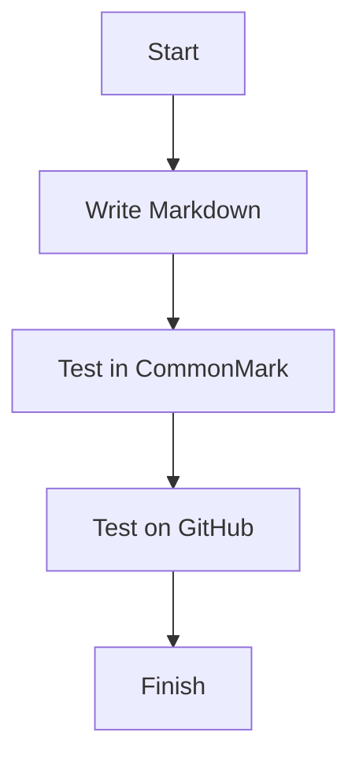

# Markdown Cheat Sheet

**Course:** Data Integration – TH Köln  
**Lab:** 01 – GitHub and Markdown  
**Author:** Karina Jacob  
**Semester:** Winter Semester 2026/2027

## Introduction

This cheat sheet provides examples of Markdown syntax and explains the differences between CommonMark and GitHub Flavored Markdown (GFM).

Each entry includes a description, the Markdown source code, the rendered result, and a category.

**Categories:**
- **CommonMark:** Features supported by the CommonMark standard and GitHub.
- **GitHub:** Additional features or rendering behavior provided by GitHub.

## Table of Contents

1. [Text](#1-text)
2. [Lists](#2-lists)
3. [Links and Images](#3-links-and-images)
4. [Code](#4-code)
5. [Quotes](#5-quotes)
6. [Tables](#6-tables)
7. [Layout](#7-layout)
8. [GitHub Extras](#8-github-extras)
9. [Pitfalls](#9-pitfalls)

---

## 1. Text

### 1.1 Headings

**Category:** CommonMark

Headings organize content into sections. Markdown supports six heading levels.

**Markdown source:**

```markdown
# Heading 1
## Heading 2
### Heading 3
```

**Rendered result:**

# Heading 1
## Heading 2
### Heading 3

### 1.2 Paragraphs

**Category:** CommonMark

Paragraphs separate blocks of text. A blank line creates a new paragraph.

**Markdown source:**

```markdown
This is the first paragraph.

This is the second paragraph.
```

**Rendered result:**

This is the first paragraph.

This is the second paragraph.

### 1.3 Line Breaks

**Category:** CommonMark

A backslash at the end of a line creates a line break without starting a new paragraph.

**Markdown source:**

```markdown
This is the first line.\
This is the second line.
```

**Rendered result:**

This is the first line.\
This is the second line.

### 1.4 Italic Text

**Category:** CommonMark

Italic formatting emphasizes words or phrases.

**Markdown source:**

```markdown
This is *italic text*.
```

**Rendered result:**

This is *italic text*.

### 1.5 Bold Text

**Category:** CommonMark

Bold formatting highlights important information.

**Markdown source:**

```markdown
This is **bold text**.
```

**Rendered result:**

This is **bold text**.

### 1.6 Bold and Italic Text

**Category:** CommonMark

Three asterisks combine bold and italic formatting.

**Markdown source:**

```markdown
This is ***bold and italic***.
```

**Rendered result:**

This is ***bold and italic***.

### 1.7 Strikethrough

**Category:** GitHub

Strikethrough formatting indicates deleted or outdated information.

**Markdown source:**

```markdown
This information is ~~outdated~~.
```

**Rendered result:**

This information is ~~outdated~~.

### 1.8 Inline Code

**Category:** CommonMark

Inline code highlights commands, variables, or short code fragments.

**Markdown source:**

```markdown
Use the `print()` function in Python.
```

**Rendered result:**

Use the `print()` function in Python.

### 1.9 Escaping Characters

**Category:** CommonMark

A backslash prevents a Markdown character from being interpreted as formatting.

**Markdown source:**

```markdown
\*This text is not italic\*
```

**Rendered result:**

\*This text is not italic\*

---

## 2. Lists

### 2.1 Unordered Lists

**Category:** CommonMark

Unordered lists organize items without a specific sequence.

**Markdown source:**

```markdown
- Python
- Java
- SQL
```

**Rendered result:**

- Python
- Java
- SQL

### 2.2 Ordered Lists

**Category:** CommonMark

Ordered lists display items in a numbered sequence.

**Markdown source:**

```markdown
1. Create a repository
2. Add a README
3. Commit changes
```

**Rendered result:**

1. Create a repository
2. Add a README
3. Commit changes

### 2.3 Nested Lists

**Category:** CommonMark

Nested lists represent hierarchical relationships between items.

**Markdown source:**

```markdown
- Programming
  - Python
  - Java
- Databases
  - SQL
  - MongoDB
```

**Rendered result:**

- Programming
  - Python
  - Java
- Databases
  - SQL
  - MongoDB

### 2.4 Task Lists

**Category:** GitHub

Task lists use checkboxes to track completed and unfinished tasks.

**Markdown source:**

```markdown
- [x] Create GitHub account
- [x] Create repository
- [ ] Finish Markdown cheat sheet
```

**Rendered result:**

- [x] Create GitHub account
- [x] Create repository
- [ ] Finish Markdown cheat sheet

---

## 3. Links and Images

### 3.1 Inline Links

**Category:** CommonMark

Inline links connect text to a website or another resource.

**Markdown source:**

```markdown
[Visit GitHub](https://github.com)
```

**Rendered result:**

[Visit GitHub](https://github.com)

### 3.2 Reference-Style Links

**Category:** CommonMark

Reference-style links separate the visible link text from the URL definition.

**Markdown source:**

```markdown
Visit [GitHub][github].

[github]: https://github.com
```

**Rendered result:**

Visit [GitHub][github].

[github]: https://github.com

### 3.3 Relative Links

**Category:** CommonMark

Relative links connect files within the same repository without requiring an absolute URL.

**Markdown source:**

```markdown
[Repository README](../../README.md)
```

**Rendered result:**

[Repository README](../../README.md)

**Note:** This link points from `labs/01/cheatsheet.md` to the README in the repository root. CommonMark supports the link syntax, while successful navigation depends on the file structure.

### 3.4 Links to Sections

**Category:** GitHub

Section links allow readers to navigate directly to headings in the same document. GitHub automatically generates heading anchors.

**Markdown source:**

```markdown
[Go to Lists](#2-lists)
```

**Rendered result:**

[Go to Lists](#2-lists)

### 3.5 Images with Alt Text

**Category:** CommonMark

Images use an exclamation mark before the link syntax. Alternative text describes the image for accessibility.

**Markdown source:**

```markdown

```

**Rendered result:**


### 3.6 Images as Links

**Category:** CommonMark

An image can be placed inside a link to make the image clickable.

**Markdown source:**

```markdown
[](https://github.com)
```

**Rendered result:**

[](https://github.com)

---

## 4. Code

### 4.1 Python Code Block

**Category:** GitHub

Fenced code blocks display programming code. GitHub provides syntax highlighting based on the specified language.

**Markdown source:**

````markdown
```python
name = "Karina"
print("Hello", name)
```
````

**Rendered result:**

```python
name = "Karina"
print("Hello", name)
```

**Note:** Fenced code blocks are supported by CommonMark, but language-specific syntax highlighting is a renderer feature.

### 4.2 Bash Code Block

**Category:** GitHub

Bash code blocks display shell commands with syntax highlighting.

**Markdown source:**

````markdown
```bash
echo "Hello World"
pwd
ls
```
````

**Rendered result:**

```bash
echo "Hello World"
pwd
ls
```

### 4.3 JSON Code Block

**Category:** GitHub

JSON code blocks improve the readability of structured data.

**Markdown source:**

````markdown
```json
{
  "name": "Karina",
  "course": "Data Integration",
  "semester": "2026/2027"
}
```
````

**Rendered result:**

```json
{
  "name": "Karina",
  "course": "Data Integration",
  "semester": "2026/2027"
}
```

---

## 5. Quotes

### 5.1 Blockquotes

**Category:** CommonMark

Blockquotes highlight quoted text using the greater-than symbol.

**Markdown source:**

```markdown
> Data is an important resource.
```

**Rendered result:**

> Data is an important resource.

### 5.2 Nested Blockquotes with Formatting

**Category:** CommonMark

Blockquotes can be nested and can contain Markdown formatting.

**Markdown source:**

```markdown
> This is the first level.
>
> > This is a **nested quotation** with *italic text*.
```

**Rendered result:**

> This is the first level.
>
> > This is a **nested quotation** with *italic text*.

### 5.3 GitHub Alerts

**Category:** GitHub

GitHub alerts highlight information using special labels, colors, and icons.

**Markdown source:**

```markdown
> [!IMPORTANT]
> Always verify your Markdown examples.
```

**Rendered result:**

> [!IMPORTANT]
> Always verify your Markdown examples.

---

## 6. Tables

### 6.1 Tables with Aligned Columns

**Category:** GitHub

Tables organize information in rows and columns. Colons in the separator row control text alignment.

**Markdown source:**

```markdown
| Name | Subject | Grade |
|:-----|:-------:|------:|
| Anna | Python | 1.3 |
| Ben | SQL | 2.0 |
| Clara | Java | 1.7 |
```

**Rendered result:**

| Name | Subject | Grade |
|:-----|:-------:|------:|
| Anna | Python | 1.3 |
| Ben | SQL | 2.0 |
| Clara | Java | 1.7 |

### 6.2 Tables Containing Links and Pipes

**Category:** GitHub

Table cells can contain links. A backslash escapes a pipe character so it does not create another column.

**Markdown source:**

```markdown
| Resource | Description |
|----------|-------------|
| [GitHub](https://github.com) | Code hosting |
| Python \| SQL | Programming languages |
```

**Rendered result:**

| Resource | Description |
|----------|-------------|
| [GitHub](https://github.com) | Code hosting |
| Python \| SQL | Programming languages |

---

## 7. Layout

### 7.1 Horizontal Rules

**Category:** CommonMark

Horizontal rules visually separate sections of a document.

**Markdown source:**

```markdown
Text above the line.

---

Text below the line.
```

**Rendered result:**

Text above the line.

---

Text below the line.

### 7.2 Collapsed Sections

**Category:** GitHub

HTML details elements create expandable sections in GitHub documents.

**Markdown source:**

```markdown
<details>
<summary>Click to expand</summary>

This information is hidden until expanded.

</details>
```

**Rendered result:**

<details>
<summary>Click to expand</summary>

This information is hidden until expanded.

</details>

**Note:** CommonMark permits raw HTML. The interactive behavior depends on the renderer and browser, so this entry is classified by its GitHub rendering behavior.

### 7.3 Hidden Comments

**Category:** CommonMark

HTML comments are present in the source file but do not appear as visible text in the rendered document.

**Markdown source:**

```markdown
<!-- This is a hidden comment. -->

This text is visible.
```

**Rendered result:**

<!-- This is a hidden comment. -->

This text is visible.

---

## 8. GitHub Extras

### 8.1 Footnotes

**Category:** GitHub

Footnotes provide additional information without interrupting the main text.

**Markdown source:**

```markdown
Markdown is widely used on GitHub.[^example-note]

[^example-note]: This is an example footnote.
```

**Rendered result:**

Markdown is widely used on GitHub.[^example-note]

[^example-note]: This is an example footnote.

### 8.2 Emoji Shortcodes

**Category:** GitHub

GitHub converts supported emoji shortcodes into emoji characters.

**Markdown source:**

```markdown
Great job! :tada:

I like Markdown! :+1:
```

**Rendered result:**

Great job! :tada:

I like Markdown! :+1:

### 8.3 Mentions and Issue References

**Category:** GitHub

Mentions refer to GitHub users, while issue references connect discussions to repository issues.

**Markdown source:**

```markdown
Hello @octocat!

Please check issue #1.
```

**Rendered result:**

Hello @octocat!

Please check issue #1.

**Test instructions:**

1. Create an issue in the `data-integration-labs` repository.
2. Note its actual issue number.
3. Post a comment mentioning your own username and referencing the issue number.
4. Compare the results in the issue comment and this Markdown file.
5. Document differences in the Pitfalls section.

**Note:** The number `#1` is an example and should be replaced if the created issue has a different number. GitHub's automatic linking behavior depends on the context.

### 8.4 Mermaid Diagrams

**Category:** GitHub

Mermaid creates diagrams from text-based descriptions.

**Markdown source:**

````markdown

````

**Rendered result:**


### 8.5 Mathematical Formulas

**Category:** GitHub

GitHub supports mathematical expressions using LaTeX syntax.

**Markdown source:**

```markdown
Einstein's equation is $E = mc^2$.
```

**Rendered result:**

Einstein's equation is $E = mc^2$.

---

## 9. Pitfalls

The following are example observations to verify during testing. They should be updated to reflect the actual test results.

### Pitfall 1: Line Breaks Disappear

**Problem:**

I expected two consecutive lines in the Markdown source to appear on separate lines in the rendered document.

**Markdown source:**

```markdown
First line
Second line
```

**Observation to verify:**

CommonMark treats a single newline inside a paragraph as a soft line break, which may appear as a space when rendered.

**Solution:**

I can use a backslash at the end of the first line to create a hard line break.

```markdown
First line\
Second line
```

### Pitfall 2: Tables Are Not Part of CommonMark

**Problem:**

I expected a Markdown table to work in both CommonMark and GitHub.

**Markdown source:**

```markdown
| A | B |
|---|---|
| 1 | 2 |
```

**Observation to verify:**

The CommonMark reference implementation does not recognize this syntax as a table, while GitHub Flavored Markdown does.

**Solution:**

I use GitHub Flavored Markdown when working with tables and verify the result in GitHub Preview.

### Pitfall 3: Issue References Behave Differently

**Problem:**

I expected `#1` and `@username` to create links in every Markdown environment.

**Markdown source:**

```markdown
Please check issue #1.

Hello @username!
```

**Observation to verify:**

CommonMark does not automatically interpret these expressions as GitHub issue references or user mentions. On GitHub, the behavior may depend on whether the text appears in a Markdown file or an issue comment.

**Solution:**

I compare the rendering in my Markdown file and in an issue comment. I use a real issue number and my own GitHub username.

### Additional Notes

The tests demonstrate that Markdown rendering depends on the supported specification and the platform.

CommonMark provides a standardized foundation for Markdown syntax. GitHub extends it with features such as tables, task lists, alerts, diagrams, and mathematical expressions.

Testing Markdown in different environments helps identify compatibility issues.

---

## References

- [CommonMark Specification](https://spec.commonmark.org/)
- [CommonMark Dingus](https://spec.commonmark.org/dingus/)
- [GitHub Flavored Markdown Specification](https://github.github.com/gfm/)
- [GitHub Markdown Documentation](https://docs.github.com/en/get-started/writing-on-github)


