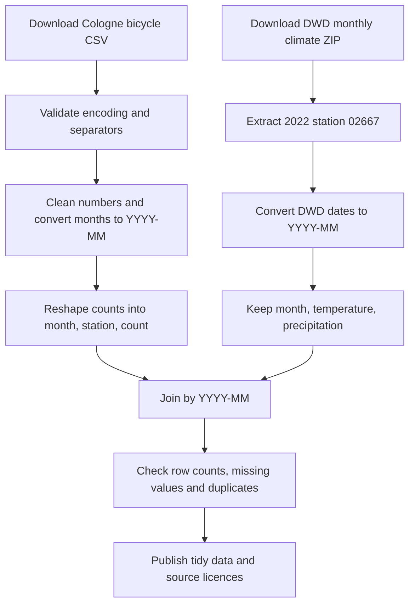

# Lab 01 – Open Data: Dataset Profile and Integration Plan

**Course:** Data Integration, TH Köln  
**Tasks:** 5–8  
**Date of research:** 12 November 2026  
**Dataset:** Fahrrad Verkehrsdaten Köln 2022  
**Candidate project topic:** Relationship between bicycle traffic and weather in Cologne

> **Verification note:** The original bicycle-count CSV was inspected programmatically on 12 November 2026 using Python and pandas. API search results and the separate DWD source were not directly validated from downloaded API/ZIP contents; those items are identified as needing verification.

## Task 5 – Find a dataset

### 5.1 Search history

I searched two different types of open-data portals:

| Source type | Portal | Search term | Result |
| --- | --- | --- | --- |
| City/state portal | [Open.NRW](https://open.nrw/dataset/fahrrad-verkehrsdaten-koln-2022-k) | `Fahrrad Verkehrsdaten Köln 2022` | Dataset published by Stadt Köln; CSV available |
| National portal | [GovData](https://www.govdata.de/suche?format=html&groups=tran&publisher=Stadt+K%C3%B6ln&sort=title_desc) | `Fahrrad Verkehrsdaten Köln 2022` | The same dataset is indexed in the national catalogue |

I selected the original dataset published by the **Stadt Köln** and listed by Open.NRW, rather than relying on a third-party copy.

**Original-publisher link:** [Offene Daten Köln – bicycle counts 2022](https://www.offenedaten-koeln.de/dataset/fahrrad-verkehrsdaten-koeln-2022)  
**Working metadata page:** [Open.NRW – Fahrrad Verkehrsdaten Köln 2022](https://open.nrw/dataset/fahrrad-verkehrsdaten-koln-2022-k)

### 5.2 Search like a machine (CKAN API)

I used the browser API request specified in the exercise:

[Open.NRW API search: `q=fahrrad&rows=1`](https://open.nrw/api/3/action/package_search?q=fahrrad&rows=1)

In the JSON response, find:

- `result.count` – number of matching datasets: **TO VERIFY**
- `result.results[0].title` – title of the first result: **TO VERIFY**
- `result.results[0].license_id` – dataset-level licence, if provided.
- `result.results[0].resources[*].license` – any resource-level licences.

To inspect the **selected** dataset independently of search ranking, open [its package metadata](https://ckan.open.nrw.de/api/3/action/package_show?id=fahrrad-verkehrsdaten-koln-2022-k). The Open.NRW landing page explicitly indicates **Datenlizenz Deutschland – Zero – Version 2.0** for the CSV distribution. This is more reliable than inferring rights solely from an `isopen` flag.

### 5.3 Why I chose this dataset

The data are published by the original public authority, are available in machine-readable **CSV**, cover one full calendar year and support analysis of changes in bicycle traffic by month. The dataset could later be combined with monthly weather observations for Cologne.

## Task 6 – Profile the dataset

### 6.1 Facts

| Property | Value |
| --- | --- |
| Title | Fahrrad Verkehrsdaten Köln 2022 |
| Original publisher | Stadt Köln, Amt für nachhaltige Mobilitätsentwicklung |
| Data portal | [Offene Daten Köln](https://www.offenedaten-koeln.de/dataset/fahrrad-verkehrsdaten-koeln-2022); indexed by [Open.NRW](https://open.nrw/dataset/fahrrad-verkehrsdaten-koln-2022-k) and GovData |
| Identifier / landing page | [Open.NRW dataset](https://open.nrw/dataset/fahrrad-verkehrsdaten-koln-2022-k) |
| Format | CSV; additional HTML link to bicycle counter map |
| File size | **1,864 bytes**, verified from the uploaded CSV |
| Dataset dimensions | **12 data rows × 18 columns:** one unnamed month column and 17 counting-station columns; **204 numeric station values** |
| Geographic coverage | Cologne, Germany; 17 automatic bicycle counting stations |
| Temporal coverage | January–December 2022 |
| Granularity | Monthly counts by counting station |
| Dataset metadata last updated | **27 November 2025**, as displayed by Open.NRW |
| Distribution last updated | **18 November 2025**, as displayed by Open.NRW |
| Update frequency | Historical annual file; this **2022 file is not a live feed**. No dependable scheduled update frequency is stated for it |
| Licence | [Datenlizenz Deutschland – Zero – Version 2.0](https://www.govdata.de/dl-de/zero-2-0) |

**CSV file:** [Download from original publisher](https://www.offenedaten-koeln.de/sites/default/files/distribution/Radverkehr%2520f%25C3%25BCr%2520Offene%2520Daten%2520K%25C3%25B6ln%25202022.csv)

### 6.2 Five-star open data

**Rating: ★★★ (3/5).** The file is openly licensed, structured and provided in an open, non-proprietary CSV format. To reach ★★★★, the observations and counting stations would need individually addressable, persistent web identifiers (URIs), rather than existing only as CSV cells. ★★★★★ would additionally require meaningful links to other datasets.

**Sources:** [5-star open data](https://5stardata.info/en/) · [Open.NRW dataset metadata](https://open.nrw/dataset/fahrrad-verkehrsdaten-koln-2022-k)

### 6.3 Inspect the actual CSV and calculate statistics

**Tool used:** Python 3 with pandas; inspection of the original uploaded CSV (not inferred from metadata).  
**File:** `Radverkehr für Offene Daten Köln 2022.csv` (1,864 bytes).  
**Import settings:** Latin-1 encoding (`encoding="latin-1"`); semicolon separator (`sep=";"`); read station values as strings, then remove German thousands dots before integer conversion.

| Numeric column | Minimum (bicycles/month) | Maximum (bicycles/month) | Mean (bicycles/month) | Missing values |
| --- | ---: | ---: | ---: | ---: |
| `Deutzer Brücke` | 83,211 (February) | 199,040 (August) | 142,528.83 | 0 |
| `Hohenzollernbrücke` | 43,723 (December) | 104,883 (August) | 73,095.25 | 0 |

**Empty-cell check:** There are **0 empty cells** in the `Deutzer Brücke` column (12 monthly records). The entire 12 × 18 CSV data area also has **0 empty cells**. This check concerns empty cells, not potential unreported counting outages or measurement errors.

**Data-quality observations:**

1. The first header cell is blank and contains German month names (`Januar`, `Februar`, …, `Dezember`); it should be renamed `month`.
2. German umlauts require the **Latin-1** encoding; decoding the file as UTF-8 fails.
3. The separator is a **semicolon**, not a comma.
4. A value such as `88.423` represents **88,423** bicycles, not 88.423 bicycles; dots are thousands separators.
5. There are no total rows, no additional yearly totals and no missing cells in the uploaded file.
6. The column `Universitäts-straße` contains a hyphen within the name; this header should be retained as published or documented when normalising.

**Reproducible calculation (Python):**

```python
import pandas as pd

file = "Radverkehr für Offene Daten Köln 2022.csv"
df = pd.read_csv(file, encoding="latin-1", sep=";", dtype=str)
df = df.rename(columns={df.columns[0]: "month"})

for name in df.columns[1:]:
    df[name] = pd.to_numeric(df[name].str.replace(".", "", regex=False))

for station in ["Deutzer Brücke", "Hohenzollernbrücke"]:
    print(station, df[station].min(), df[station].max(), df[station].mean())
print("Empty cells, Deutzer Brücke:", df["Deutzer Brücke"].isna().sum())
```

### 6.4 Data dictionary (five columns)

The CSV contains an unnamed month column and 17 station columns. The following five entries use **exact column headings and actual example values** from the inspected file; the descriptive name `month` is supplied for the first, originally blank, header.

| Column (CSV header) | Meaning | Type / unit | Example value from January 2022 |
| --- | --- | --- | --- |
| *(blank; renamed `month`)* | Calendar month for the observation, with year 2022 supplied by the file title | Text month (`Januar`) → ISO-style `YYYY-MM` | `Januar` → `2022-01` |
| `Deutzer Brücke` | Total bicycles counted at Deutzer Brücke in that month | Integer / bicycles per month | `88.423` → 88,423 |
| `Hohenzollernbrücke` | Total bicycles counted at Hohenzollernbrücke in that month | Integer / bicycles per month | `52.307` → 52,307 |
| `Neumarkt` | Total bicycles counted at Neumarkt in that month | Integer / bicycles per month | `84.708` → 84,708 |
| `Zülpicher Straße` | Total bicycles counted at Zülpicher Straße in that month | Integer / bicycles per month | `104.967` → 104,967 |

**Publisher documentation:** The [Open.NRW dataset page](https://open.nrw/dataset/fahrrad-verkehrsdaten-koln-2022-k) describes monthly bicycle counts and provides source metadata, but no dedicated per-column data dictionary was established. Meanings in the table follow the published station labels and the dataset description.

### 6.5 Licence and TASL attribution

**Open Definition:** Yes. The **Datenlizenz Deutschland – Zero – Version 2.0** permits unrestricted reuse of the dataset and is recognised as an open licence. An attribution is not legally required by this Zero licence, but I will provide one for transparent provenance.

**TASL for the project README:**

> **Title:** Fahrrad Verkehrsdaten Köln 2022. **Author:** Stadt Köln, Amt für nachhaltige Mobilitätsentwicklung. **Source:** [Offene Daten Köln / Open.NRW](https://open.nrw/dataset/fahrrad-verkehrsdaten-koln-2022-k). **Licence:** [Datenlizenz Deutschland – Zero – Version 2.0](https://www.govdata.de/dl-de/zero-2-0). **Changes:** Month names and numerical formats will be standardised in the integrated dataset.

### 6.6 Personal data

The published dataset consists of aggregated counts of bicycles at fixed counting locations, not directly identifying observations about individual cyclists. No names or person-level records are described in the metadata. Reidentification risk is therefore low for this published aggregate. Any future enrichment should retain aggregate counts and avoid linking to person-level movement traces.

## Task 7 – FAIR review

Legend: **✓** yes · **~** partly · **✗** no

| Principle | Rating | Evidence and assessment |
| --- | :---: | --- |
| **F1** – Unique and persistent identifier | ~ | [Dataset landing page](https://open.nrw/dataset/fahrrad-verkehrsdaten-koln-2022-k) is a usable identifier; no DOI established in inspected metadata |
| **F2** – Rich metadata | ✓ | [Open.NRW](https://open.nrw/dataset/fahrrad-verkehrsdaten-koln-2022-k) provides title, description, publisher, creation/update dates, location, category and licence |
| **F4** – Indexed/searchable | ✓ | Discoverable through [Open.NRW](https://open.nrw/dataset/fahrrad-verkehrsdaten-koln-2022-k) and [GovData](https://www.govdata.de/suche?format=html&groups=tran&publisher=Stadt+K%C3%B6ln&sort=title_desc) |
| **A1** – Accessible using standard protocol | ✓ | CSV download and metadata use HTTPS; no login indicated by landing page |
| **I1** – Open, machine-readable format | ✓ | CSV download is listed in the [resources](https://open.nrw/dataset/fahrrad-verkehrsdaten-koln-2022-k) |
| **I2 / I3** – Standard codes and links | ~ | The inspected CSV uses German month names and station names rather than standardised codes; metadata points to a related counter map, but no demonstrated row-level linked-data identifiers |
| **R1** – Sufficient documentation | ~ | The CSV has readable station headers, but its month header is blank and no dedicated publisher data dictionary or detailed methods were established |
| **R1.1** – Clear machine-readable licence | ✓ | Licence listed on dataset/resource [metadata page](https://open.nrw/dataset/fahrrad-verkehrsdaten-koln-2022-k); verify exact API fields during Task 5 |
| **R1.2** – Provenance | ~ | Publisher and responsible office identified; counter method, calibration, missing-value handling and quality control need more detail |
| **R1.3** – Community metadata standard | ~ | Open.NRW exposes [JSON and RDF/XML metadata](https://open.nrw/dataset/fahrrad-verkehrsdaten-koln-2022-k), but explicit DCAT-AP conformance was not established in this review |

**Assessment:** The dataset is clearly **open**, because its licence permits reuse, and it satisfies many FAIR criteria, but it is **not fully FAIR**. The main weaknesses are the unlabeled month column, incomplete published field documentation, limited persistent identifiers and insufficient provenance detail. For milestone 2 I would improve the publication with (1) a complete machine-readable data dictionary, (2) standard ISO 8601 month values and stable station identifiers, and (3) a versioned dataset with explicit provenance, licence metadata and quality checks.

**Reference:** [FAIR principles](https://www.gofair.foundation/fair-principles)

## Task 8 – Plan a second dataset and an integration

### 8.1 Second source

I would join the bicycle counts with **monthly climate observations** of the Deutscher Wetterdienst (DWD), station **02667 – Köln/Bonn**, for **2022**.

- **Original publisher:** Deutscher Wetterdienst (DWD), Climate Data Center (CDC)
- **Source:** [DWD monthly historical climate data](https://opendata.dwd.de/climate_environment/CDC/observations_germany/climate/monthly/kl/historical/)
- **Relevant archive:** `monatswerte_KL_02667_19570901_20251231_hist.zip` (archive name at time of research; source files may be revised)
- **Licence:** [CC BY 4.0, DWD CDC terms of use](https://opendata.dwd.de/climate_environment/CDC/Nutzungsbedingungen_German.pdf)
- **Useful variables:** month, mean temperature (°C), monthly precipitation (mm)

### 8.2 Shared key and example values

Both datasets refer to calendar months. They need to be normalised to the same ISO-like `YYYY-MM` key before joining.

| Source | Published example | Clean join key |
| --- | --- | --- |
| Cologne bicycle counts | `Januar` (2022 appears in the file name) | `2022-01` |
| DWD station 02667 | `MESS_DATUM_BEGINN = 20220101` | `2022-01` |
| Cologne bicycle counts | `Februar` | `2022-02` |
| DWD station 02667 | `MESS_DATUM_BEGINN = 20220201` | `2022-02` |
| Cologne bicycle counts | `März` | `2022-03` |
| DWD station 02667 | `MESS_DATUM_BEGINN = 20220301` | `2022-03` |

The first pair is given in the course's example. The other month codes show the expected date mapping and must be confirmed in the two downloaded files before joining.

### 8.3 Granularity and alignment

The bicycle file contains **one monthly value per counting station**, whereas DWD provides **one monthly weather observation per meteorological station**. I would reshape the wide bicycle CSV into a tidy table with columns `month`, `counter_station` and `bicycle_count`. The single DWD monthly observation would then be joined onto each Cologne counter station using the month key. This assumes the Köln/Bonn weather station is a reasonable proxy for the city: local weather variation cannot be measured with this one station.

### 8.4 Research questions

1. Are bicycle counts in Cologne higher in months with higher mean temperatures?
2. Are monthly bicycle counts lower in months with higher precipitation?
3. Do counting stations differ in their apparent sensitivity to temperature and rainfall?

These are **associations**, not proof that weather caused changes in bicycle usage. Twelve monthly observations provide only limited statistical power and can be confounded by seasonality.

### 8.5 Licence compatibility

The bicycle data are under **Datenlizenz Deutschland – Zero – Version 2.0** and DWD weather data are under **CC BY 4.0**. They can be combined and the transformed dataset can be redistributed, provided the DWD is appropriately attributed and changes are indicated. I would publish my own cleaned/joined output under **CC BY 4.0**, while retaining source-level attribution and licence metadata for both inputs. A separate repository MIT licence for software code does not automatically relicense third-party data.

**TASL – DWD weather:** **Title:** Historical monthly climate observations, station 02667 (Köln/Bonn). **Author:** Deutscher Wetterdienst, Climate Data Center. **Source:** [DWD CDC](https://opendata.dwd.de/climate_environment/CDC/observations_germany/climate/monthly/kl/historical/). **Licence:** [CC BY 4.0](https://creativecommons.org/licenses/by/4.0/). **Changes:** Restricted to 2022, dates converted to monthly keys and merged with Cologne bicycle counts.

### 8.6 Processing plan



**Practical validation:** Verify that each station has at most 12 month records; the weather table has one record per month; the join does not duplicate rows; and the output retains 2022 only. Record the two original source files and the transformation steps.

### 8.7 Verdict (three sentences)

I would use this dataset as the starting point of my project because it is openly licensed, easy to understand and can be enriched with official monthly weather observations. The biggest risk is the small sample of twelve months and incomplete documentation of the individual counting stations. Before continuing to milestone 2, I would standardise the verified CSV encoding, numbers and month values, obtain the DWD data and document the limitations of the weather-station proxy.

## References

1. [Open.NRW – Fahrrad Verkehrsdaten Köln 2022](https://open.nrw/dataset/fahrrad-verkehrsdaten-koln-2022-k)
2. [Offene Daten Köln – original dataset](https://www.offenedaten-koeln.de/dataset/fahrrad-verkehrsdaten-koeln-2022)
3. [GovData – Stadt Köln search results](https://www.govdata.de/suche?format=html&groups=tran&publisher=Stadt+K%C3%B6ln&sort=title_desc)
4. [Open.NRW – CKAN search API](https://open.nrw/api/3/action/package_search?q=fahrrad&rows=1)
5. [5-star open data](https://5stardata.info/en/)
6. [FAIR principles](https://www.gofair.foundation/fair-principles)
7. [DWD monthly climate data archive](https://opendata.dwd.de/climate_environment/CDC/observations_germany/climate/monthly/kl/historical/)
8. [DWD CDC terms of use](https://opendata.dwd.de/climate_environment/CDC/Nutzungsbedingungen_German.pdf)
9. [Open Definition – conformant licences](https://opendefinition.org/licenses/)
